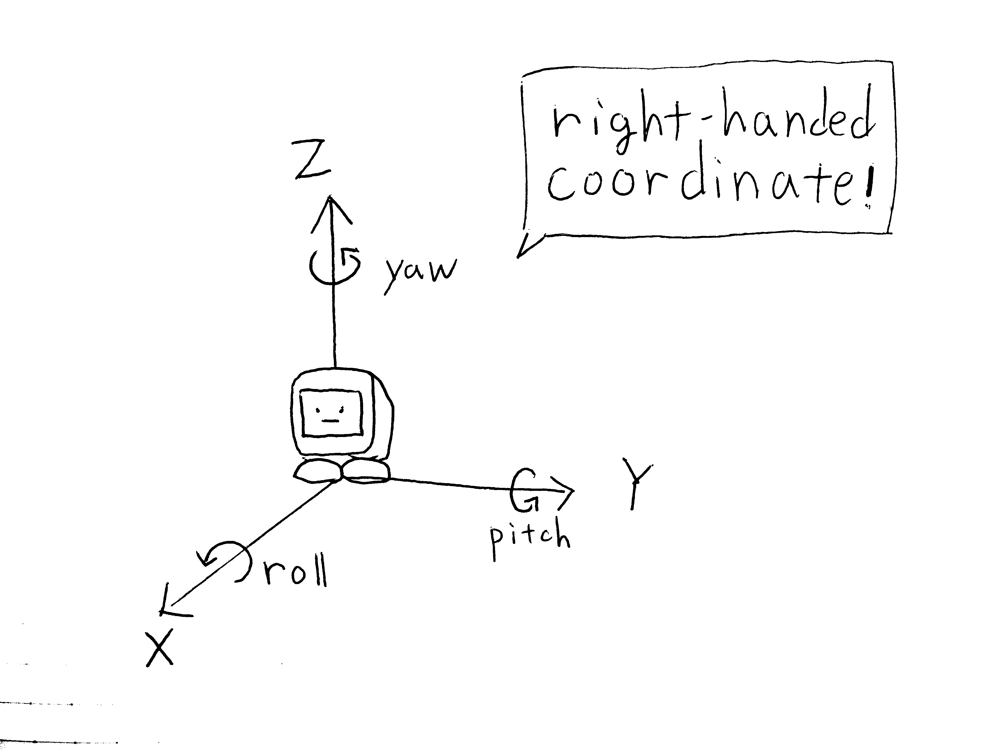

# API

[English](./api.md)

APIの詳しいドキュメントは現在作成中です。

ｽﾀｯｸﾁｬﾝのソースコードには `TSDoc` 形式のコメントがついています。
このリポジトリでは、Node.js 側の検査と API ドキュメント生成のために `firmware/tsconfig.json` を保持しています。

次のコマンドを実行すると、`docs/api` ディレクトリ配下にドキュメントを生成できます。

```console
$ npm run generate-apidoc
```

## 構成

MODは`onContextCreated`から`StackchanContext`を受け取ります。
`StackchanContext`は、UI、motion、speech、inputの実装を独立して差し替えられるように、少数のcapabilityを公開します。

- [StackchanContext](#stackchancontext): MODに渡されるruntime capabilityの集合
- [RobotUI](#robotui): Piu Application、顔、エフェクト、ドロワーUIの制御
- [Motion capability](#motion-capability): 公開 motion API による首姿勢と視線移動の制御
- [Audio capability](#audio-capability): 公開 audio API による音声再生

// TODO: capability図と説明

## 座標系



ｽﾀｯｸﾁｬﾝの座標系は **右手系** です。
右手の親指、人差し指と中指がそれぞれ直行するように曲げたとき、
親指がX軸、人差し指がY軸、中指がZ軸となります。

ｽﾀｯｸﾁｬﾝの顔が正面を向いているとき、各軸の正の方向は次のとおりです。

- X軸の正方向…顔の前側
- Y軸の正方向…顔の左側
- Z軸の正方向…頭側

また、回転の向きは軸の正の方向に対して右ねじが進む向きとなります。
ｽﾀｯｸﾁｬﾝの顔でいうと、各軸の周りを正の方向へ回転する場合次のようになります。

- ロール軸（X軸まわりの回転）の正方向…ｽﾀｯｸﾁｬﾝから見て時計回りに首をかしげる動き
- ピッチ軸（Y軸まわりの回転）の正方向…ｽﾀｯｸﾁｬﾝが下を向く動き
- ヨー軸（Z軸まわりの回転）の正方向…ｽﾀｯｸﾁｬﾝが左を向く動き

ｽﾀｯｸﾁｬﾝのAPIにおいては **座標の単位はメートル、角度の単位はラジアンになります** 。
座標系との対応は実際のソースコード（[`mods/examples/look_around`](../mods/examples/look_around/)など）も参考にしてください。

## 型

### StackchanContext

`StackchanContext` は namespaced capability を公開します。
新しい MOD では次の形式を推奨します。

- `context.audio.say(...)`、`context.audio.record(...)`、`context.audio.playAudio(...)`
- MOD が speech engine の選択を所有する場合の `context.audio.useTTS(...)`
- `context.motion.lookAt(...)`、`context.motion.setPose(...)`、`context.motion.setTorque(...)`
- `context.face.setEmotion(...)`、`context.face.setColor(...)`
- `context.i18n.locale`、`context.i18n.localize(...)`
- `context.ui.showBalloon(...)`、`context.ui.drawer.addDrawerButton(...)`
- `context.input.touch`、`context.input.touchPanel`、`context.input.imu`
- `context.lighting.lightOn(...)`、`context.camera.capture(...)`、`context.connectivity.network?.ready`、`context.connectivity.localPeer`
- runtime が所有する Timer、sensor、camera session、motion timer を解放する `context.lifecycle.close()`

input device は optional です。
`context.input.touch` は platform が `config.Touch` を公開している場合だけ定義されます。
`context.input.touchPanel` は platform が `config.TouchPanel` を公開している場合だけ定義されます。

`context.input.imu?.subscribeSamples(handler)` はHostのIMUが読み取った加速度と角速度を通知します。読み取りに失敗すると `handler` に `undefined` が渡ります。戻り値の関数で購読を解除できます。座標軸と単位は機種のドライバーに従います。K151の角速度は度毎秒です。
MOD は touch handler を登録する前に `undefined` を確認してください。

`context.connectivity.network?.ready` は `connected`、`skipped`、`failed` のいずれかへ解決されます。
network が必要な MOD は、host 内部の network module を import せずにこれを await し、`skipped` や `failed` を扱えます。
local peer sessionではESP-NOWとBLE Serialを同じAPIで利用できます。詳しくは[ローカルP2Pメッセージ通信](./local-peer-communication_ja.md)を参照してください。

`context.ui.showBalloon(text, options)` の `options.tail` では、吹き出しのトンガリを
`top-left`、`top-right`、`bottom-left`、`bottom-right` から選べます。
未指定時は、下配置なら `top-left`、`top` を指定した上配置なら `bottom-left` が選ばれます。

MOD の Drawer Button や Piu `Label` に表示する文字列は `context.i18n.localize(key, values?)` で取得します。
MOD 自身の辞書、host 辞書、キー文字列の順に解決されます。
辞書の追加方法は [Firmware のローカライズ](./localization_ja.md)を参照してください。

`context.say(...)`、`context.lookAt(...)`、`context.showBalloon(...)`、`context.useTTS(...)` などの flat API は、既存 MOD 互換の shim として残しています。
新規コードでは非推奨です。
sample MOD と downstream MOD の移行後に削除対象になります。

### ライフサイクルとエラー

runtime resource の解放には `close()` を使います。
`close()` は冪等であり、app runtime は所有する Timer、sensor、camera session、motion timer の順で解放します。
firmware runtime resource には `dispose()` を使いません。
`pause()` と `resume()` は個別操作の一時停止と再開を表す名前であり、所有権の解放には使いません。

platform が device を提供しない optional hardware capability は `undefined` で表します。
たとえば `context.input.touch`、`context.input.touchPanel`、`context.input.imu`、`context.connectivity.network` は optional です。
現在の target で実行できない必須操作は throw または reject します。
たとえば microphone がない場合、`context.audio.record()` は reject します。
未対応が通常の結果になり得る操作は、throw ではなく型付きの値を返します。
たとえば `context.audio.playAudio(buffer)` は、借用 buffer 再生が未対応または失敗した場合に `false` を返します。

`Maybe<T>` は、UI や MOD code に復旧可能な理由を返す user-facing 操作だけで使います。
呼び出し側が制御フローとして扱う非同期 command の失敗は Promise rejection で伝えます。
同期的な引数エラーは throw します。
`trace(...)` は診断を追加する目的で使えますが、public capability operation の唯一の失敗通知にしてはいけません。

wasm audio bridge は、現在の public capability 実装で唯一、非同期 host 操作を polling します。
50ms の間隔は bridge contract の `WASM_AUDIO_BRIDGE_POLL_INTERVAL_MS` として宣言し、browser audio の record/play status 確認に限定します。

### RobotUI

`RobotUI` は `context.ui` として公開される UI capability namespace です。
顔、エフェクト、ドロワー登録、ドロワーの open/close を扱い、MOD が `ui.application` の内部へ到達しなくてよい API を提供します。

### Motion capability

公開 motion API は、`pose`、`lookAt`、`lookAway`、`setPose`、`setTorque` を提供します。
低レイヤの driver object は `host/modules/motion` の内部実装であり、MOD には公開しません。

#### 首の連続回転

M5StackChan（K151）で専用サーボドライバーを使うと、`motion.startContinuousYaw` を利用できます。連続回転の操作を提供する前に、このメソッドがあるかを確かめてください。呼び出すと首を占有するセッションを出力0で開始します。他のセッションが使用中か、motionが終了済みなら拒否されます。ドライバーの切り替えなどで非対応になったときは `undefined` を返します。出力指令を送らないと最初の1秒で期限切れになります。

| セッションのメソッド | 契約 |
| --- | --- |
| `setPower(power, timeoutMs)` | `-1`〜`1`の符号付き出力を指定します。`0`で出力を止めます。期限は呼び出し時からのミリ秒で、1〜1000の整数です。回転を続けるには期限までに指令を更新してください。 |
| `readRawPosition()` | 首サーボの生の位置を返します。原点補正と角度への変換は行いません。K151では正の出力で値が減ります。1周は1152カウントで、位置が正しく読めるのはその一部です。 |
| `close()` | 首の出力を0にし、セッションを解放します。繰り返し呼び出せます。 |

読み取りや出力指令の完了を待ってから、次の指令を送ってください。処理中に届いた指令は拒否され、期限は延びません。セッションの開始時に視線の目標を取り消します。使用中の `setPose` と `setTorque` は拒否され、`lookAt` は反映されません。指令の期限切れ、出力や期限の値が不正な場合、サーボ通信のエラー、ランタイムの終了時はHostがセッションを閉じます。停止時に角度指令は送りません。角度指定や視線追従を再開するには、終了後に新しい指令を送ってください。連続回転の再開には新しいセッションが必要です。

遠隔操作のMODは通信断と自身の終了時にセッションを閉じてください。リンクが接続中でも指令が途絶えることがあるため、指令には期限を付けます。実装例は[Strider MOD](../mods/examples/strider/README_ja.md)を参照してください。

### Audio capability

公開 audio API は、MOD に渡す capability object から音声再生機能を提供します。
local、remote、Voicevox、ElevenLabs、OpenAI などの provider object は `host/modules/audio` の内部実装です。

`sing(koe, volume?)` は、使用中の TTS provider が対応している場合に stackchan-voice の歌唱記法を再生します。
歌唱非対応の provider では失敗結果を返し、歌唱記法を通常の文章として読み上げることはありません。

`playAudio(buffer)` は、target が借用 buffer を受け取り、再生が完了した場合だけ `true` を返します。
target が buffer 再生に未対応、buffer が空、または再生に失敗した場合は `false` を返します。
呼び出し側は buffer の所有権を保持し、`false` を未対応または未再生として扱ってください。

- [TTS（音声合成）の使用](./text-to-speech_ja.md)
- [stackchan-voice の発話・歌唱](./stackchan-voice.md)
