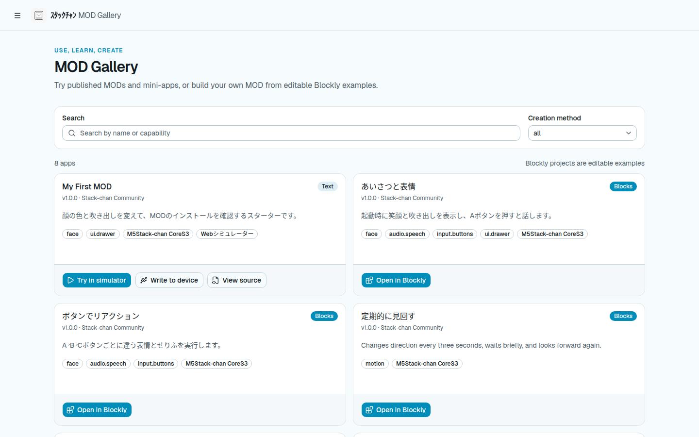
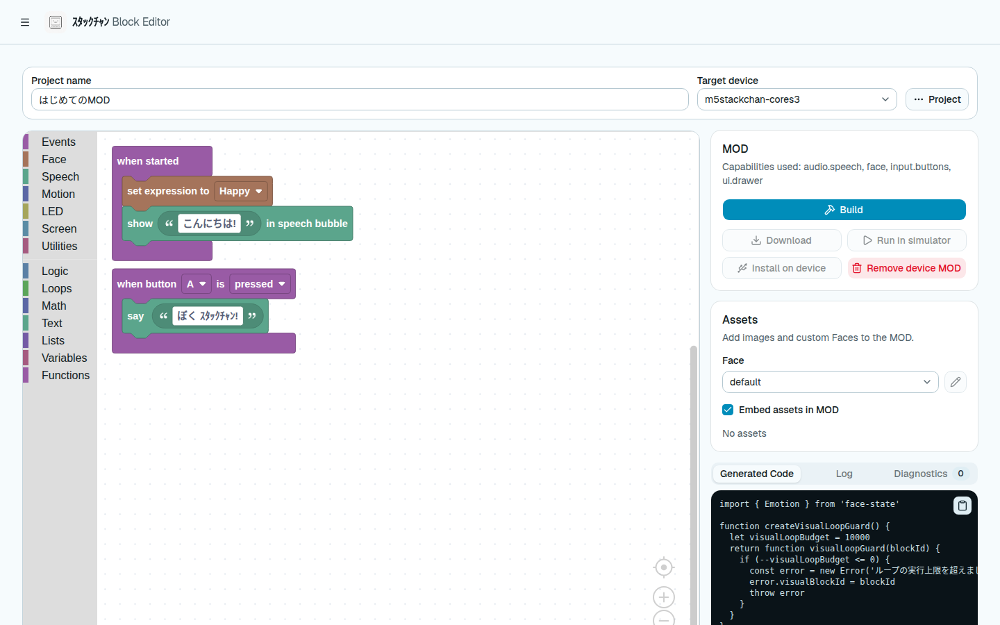

# MODs and examples

[日本語](./README_ja.md)

A **MOD** is a user application that runs on the Stack-chan host firmware.

## Try a MOD

Find published MODs in the [MOD Gallery](https://stack-chan.github.io/stack-chan/web/mod-gallery/).
Search by name or capability, then run a MOD in the simulator or on a device.
You can change block-based MODs in the block editor.

When choosing a MOD, review the capabilities and supported targets shown on its card.
If the MOD uses an external service or network access, inspect the linked source code before installing it.
At installation time, the Gallery automatically checks the target chip, XS version, and firmware compatibility.

[](https://stack-chan.github.io/stack-chan/web/mod-gallery/)

The [`examples`](./examples/) directory contains source code for learning APIs, testing, and local development.
Some examples are also published in the Gallery.
The Gallery and `examples` do not yet contain the same set of MODs, but they will be aligned over time.

## Create a MOD

### Create one in a browser

The [block editor](https://stack-chan.github.io/stack-chan/web/editor/) lets you assemble behavior with Blockly and build a MOD in the browser.
You can test the result in the [simulator](https://stack-chan.github.io/stack-chan/web/simulator/) and install it on a compatible device.
Follow the [block editor tutorial](https://stack-chan.github.io/stack-chan/web/editor/tutorial.html) to create a first project.

[](https://stack-chan.github.io/stack-chan/web/editor/)

### Create one from source

A MOD can be implemented as a JavaScript or TypeScript module.
TypeScript MODs use the public Stack-chan capability types and Moddable module specifiers.

To install a MOD from a local environment, specify its manifest from the `firmware` directory:

```console
npm run mod -- mods/examples/hello_balloon/manifest.json
```

See [Build and flash programs](../docs/flashing-firmware.md) for setup, target-specific commands, and installation details.

### Open a screen from the drawer

Use the [drawer screen example](./examples/drawer_screen/mod.ts) for a screen with a Back button and a timer. Its [manifest](./examples/drawer_screen/manifest.json) includes the SDK MOD manifest and the public type declarations.

1. Register a drawer button with `context.ui.drawer.addDrawerButton()`. In the callback, call `context.ui.closeDrawer()` before opening your screen.
2. Open your screen with `context.ui.setMain(content, { onClose })`. Connect the function it returns to your Back button.
3. Cancel the screen's timers and subscriptions in `onClose`. A queued screen replacement can call `onClose` before `setMain()` returns. If you keep the returned function as a marker that the screen is open, save it only if `onClose` has not run, as in the example. Use `scope.own()` from `defineMod()` to remove the drawer button when the MOD closes.

Use the host font `k8x12-12` for Japanese labels.

Build the example from `firmware`.

```console
npm run mod:build -- mods/examples/drawer_screen/manifest.json
```

## MOD runtime model

The host reads [hooks](../host/app/app-behavior.ts) from the named exports of the `mod` module.
For each hook that the MOD defines, the host runs the MOD's hook in place of the default hook.
If the MOD omits a hook or exports it as `undefined`, the host uses the default hook when one exists.
If there is no `mod` module or the host fails to import it, the host runs the default behavior.

A MOD must be built for the target device and the XS version used by its host.
For the WASM host, load an `.xsb` or archive built with a target that supports TypeScript, such as `lin`.

Add localized UI text as described in [Firmware localization](../docs/localization.md) through `context.i18n`.
To add a Piu UI while retaining the face screen and host AppBar, use the experimental [mini-app framework (Japanese)](../docs/mini-apps_ja.md).

### Example with one hook

The [`hello_balloon` MOD](./examples/hello_balloon/mod.js) exports only `onContextCreated`.
The host shows its default startup screen and boots through the default `onLaunch`.
Once the context is ready, the MOD's `onContextCreated` displays `Hello from a MOD!` in a speech balloon.

To run the example on Linux with the Moddable SDK and Xvfb, run the existing simulator smoke test from `firmware`.
The test loads the example archive and checks for the trace emitted after the MOD shows the balloon.

```sh
STACKCHAN_LIN_SMOKE_ARCHIVE_MANIFEST="$PWD/mods/examples/hello_balloon/manifest.json" \
STACKCHAN_LIN_SMOKE_EXPECT="[hello_balloon] balloon shown" \
npm run smoke:lin
```

The [host behavior tests](../host/app/__tests__/app-behavior.test.ts), run by `npm run test:unit`, also check that an `onContextCreated`-only MOD keeps the default `onLaunch` and that the host falls back when the MOD is absent or fails to import.

## Representative source examples

| Example | What it demonstrates |
| --- | --- |
| [`look_around`](./examples/look_around/) | Minimal head movement through the motion API |
| [`localized_drawer`](./examples/localized_drawer/) | Localized UI through `context.i18n` |
| [`mini_app_sample`](./examples/mini_app_sample/) | A mini app that retains the face screen and AppBar |
| [`stackchan_catch`](./examples/stackchan_catch/) | A Game & Watch-style mini-app with discrete falling-item states |
| [`stackchan_minigames`](./examples/stackchan_minigames/) | One mini-app archive that packages Stack-chan JUMP and CATCH together |
| [`local_peer_hello`](./examples/local_peer_hello/) | Typed device-to-device messages without the internet |
| [`web_radio`](./examples/web_radio/) | Network audio playback on M5StackChan CoreS3 |
| [`m5stackchan_smoke`](./examples/m5stackchan_smoke/) | [M5StackChan CoreS3 servo-power and head LED checks](../docs/m5stackchan-cores3-smoke.md) |

## References

- [Build and flash programs](../docs/flashing-firmware.md)
- [Firmware API](../docs/api.md)
- [MOD package specification](../../docs/specs/stackchan-mod.md)
- [Localization](../docs/localization.md)
- [Mini apps (experimental, Japanese)](../docs/mini-apps_ja.md)
