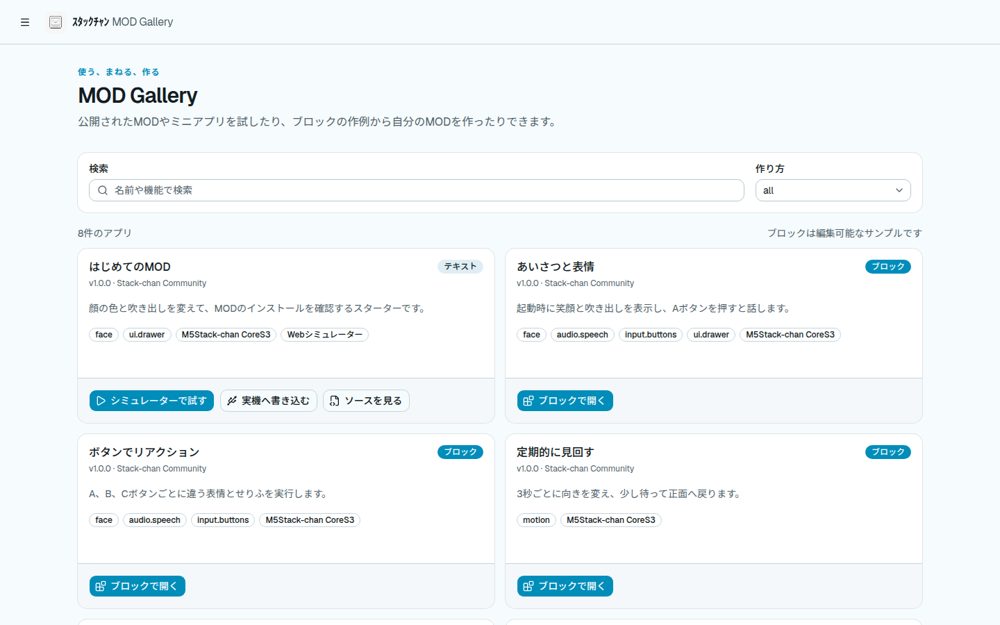
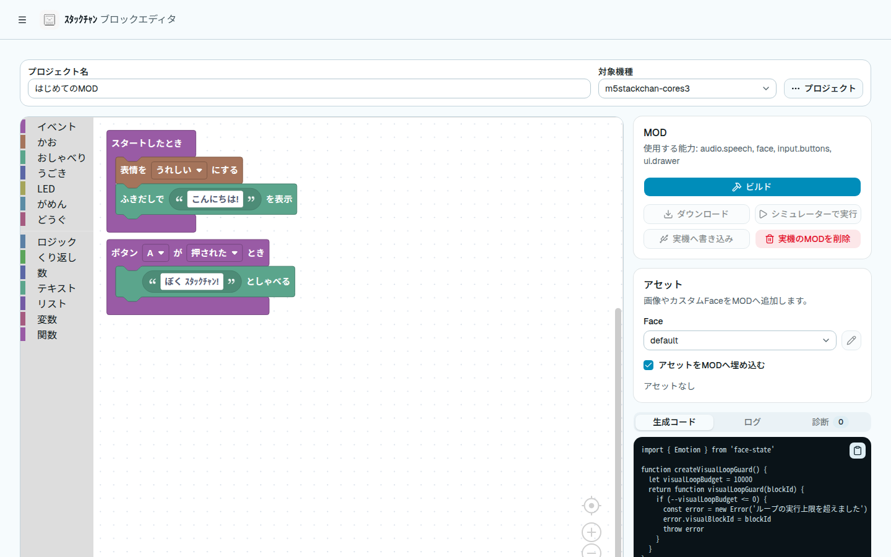

# MODとサンプル

[English](./README.md)

**MOD**は、ｽﾀｯｸﾁｬﾝのホストファームウェア上で動くユーザーアプリケーションです。

## MODを試す

公開MODは[MOD Gallery](https://stack-chan.github.io/stack-chan/web/mod-gallery/)から探せます。
名前や機能で検索し、シミュレーターまたは実機で試せます。
ブロックで作られたMODは、ブロックエディタで変更できます。

MODを選ぶときは、カードに表示される使用機能と対応機種を確認してください。
外部サービスやネットワークを使うMODは、リンク先のソースコードも確認してから書き込んでください。
実機へ書き込むときは、Galleryが対象チップ、XSバージョン、ファームウェア互換性を自動で検査します。

[](https://stack-chan.github.io/stack-chan/web/mod-gallery/)

このディレクトリの[`examples`](./examples/)には、APIの学習、テスト、ローカル開発に使えるMODのソースコードがあります。
その一部はGalleryにも掲載されています。
現在、Galleryと`examples`の収録内容は一致していませんが、今後そろえていく予定です。

## MODを作る

### ブラウザーで作る

[ブロックエディタ](https://stack-chan.github.io/stack-chan/web/editor/)では、Blocklyで処理を組み立て、ブラウザー内でMODをビルドできます。
作成したMODは[シミュレーター](https://stack-chan.github.io/stack-chan/web/simulator/)で確認し、対応する実機へ書き込めます。
最初のプロジェクトは[ブロックエディタのチュートリアル](https://stack-chan.github.io/stack-chan/web/editor/tutorial.html)に沿って作成できます。

[](https://stack-chan.github.io/stack-chan/web/editor/)

### ソースコードから作る

MODはJavaScriptまたはTypeScriptのモジュールとして実装できます。
TypeScriptのMODでは、Stack-chanのcapability APIが公開する型とModdableのモジュール指定子を使用します。

ローカル環境からMODを書き込む場合は、`firmware`ディレクトリで`manifest.json`を指定します。

```console
npm run mod -- mods/examples/hello_balloon/manifest.json
```

環境構築、ターゲット別のコマンド、書き込み方法は[プログラムのビルドと書き込み](../docs/flashing-firmware_ja.md)を参照してください。

### ドロワーから専用画面を開く

[専用画面のサンプル](./examples/drawer_screen/mod.ts)には、戻るボタンとタイマーがあります。[manifest](./examples/drawer_screen/manifest.json)にはSDKのMOD用manifestと公開型定義を指定します。

1. `context.ui.drawer.addDrawerButton()`でドロワーにボタンを登録します。コールバックでは、専用画面を開く前に`context.ui.closeDrawer()`を呼びます。
2. `context.ui.setMain(content, { onClose })`で画面を開きます。戻り値の関数を戻るボタンから呼びます。
3. `onClose`で画面のタイマーや購読を解除します。画面の置き換えが予約されていると、`setMain()`が戻る前に`onClose`が呼ばれることがあります。戻り値の関数を画面が開いている印にする場合は、サンプルのように`onClose`がまだ呼ばれていないときだけ保存します。MOD終了時のドロワーボタンの削除は`defineMod()`の`scope.own()`に登録します。

日本語を表示するラベルには、ホストのフォント`k8x12-12`を使います。

`firmware`ディレクトリからサンプルをビルドします。

```console
npm run mod:build -- mods/examples/drawer_screen/manifest.json
```

## MODの実行モデル

ホストは `mod` モジュールの名前付きエクスポートから[フック](../host/app/app-behavior.ts)を読み込みます。
MODが定義したフックでは、ホストは既定のフックに代えてMODのフックを実行します。
MODが省略したフックや `undefined` としてエクスポートしたフックには、既定のフックがあればそれを使います。
`mod` モジュールがない場合や読み込みに失敗した場合は、ホストは既定の動作に戻ります。

MODは、対象機種とホストが使用するXSバージョンに合わせてビルドする必要があります。
WASMホストで使う場合も、`lin`などTypeScriptをサポートするターゲットでビルドした`.xsb`またはアーカイブを読み込みます。

表示文字列は[`context.i18n`を使ったファームウェアのローカライズ](../docs/localization_ja.md)に従って追加します。
顔画面とホストのAppBarを維持したままPiu UIを追加する場合は、実験的な[ミニアプリ](../docs/mini-apps_ja.md)を利用できます。

### フックを1つだけ定義する例

[`hello_balloon` MOD](./examples/hello_balloon/mod.js)は `onContextCreated` だけをエクスポートします。
ホストは既定の `onLaunch` で起動画面を表示し、起動を進めます。
コンテキストが作成されると、MODの `onContextCreated` が吹き出しに `Hello from a MOD!` と表示します。

Moddable SDKとXvfbを導入済みのLinux環境では、`firmware` ディレクトリで既存のシミュレーター起動テストを実行できます。
テストはサンプルのアーカイブを読み込み、MODが吹き出しを表示した後に出すログを確認します。

```sh
STACKCHAN_LIN_SMOKE_ARCHIVE_MANIFEST="$PWD/mods/examples/hello_balloon/manifest.json" \
STACKCHAN_LIN_SMOKE_EXPECT="[hello_balloon] balloon shown" \
npm run smoke:lin
```

`npm run test:unit` で実行される[ホストの動作テスト](../host/app/__tests__/app-behavior.test.ts)では、`onContextCreated` だけを定義したMODでも既定の `onLaunch` が使われることと、MODがない場合や読み込みに失敗した場合に既定の動作へ戻ることを確認しています。

## 代表的なソース例

| サンプル | 確認できる機能 |
| --- | --- |
| [`look_around`](./examples/look_around/) | モーションAPIを使った最小限の首振り |
| [`localized_drawer`](./examples/localized_drawer/) | `context.i18n`を使ったローカライズ済みUI |
| [`mini_app_sample`](./examples/mini_app_sample/) | 顔画面とAppBarを維持するミニアプリ |
| [`stackchan_catch`](./examples/stackchan_catch/) | 落下物を離散状態で動かすゲーム&ウォッチ風ミニアプリ |
| [`stackchan_minigames`](./examples/stackchan_minigames/) | JUMPとCATCHを1つのarchiveへまとめるミニゲーム集 |
| [`local_peer_hello`](./examples/local_peer_hello/) | インターネットを経由しない端末間の型付きメッセージ |
| [`web_radio`](./examples/web_radio/) | M5StackChan CoreS3でのネットワーク音声再生 |
| [`m5stackchan_smoke`](./examples/m5stackchan_smoke/) | [M5StackChan CoreS3のサーボ電源とヘッドLEDの確認](../docs/m5stackchan-cores3-smoke.md) |

## 参考資料

- [プログラムのビルドと書き込み](../docs/flashing-firmware_ja.md)
- [ファームウェアAPI](../docs/api_ja.md)
- [MODパッケージ仕様](../../docs/specs/stackchan-mod.md)
- [ローカライズ](../docs/localization_ja.md)
- [ミニアプリ（実験的）](../docs/mini-apps_ja.md)
